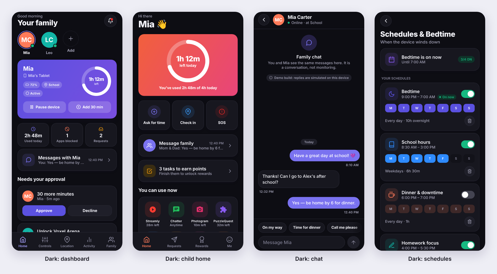

# Haven

A family-safety app with a parent side and a child side, built with React Native and Expo (SDK 58, Expo Router, TypeScript). One codebase builds a combined app and two separate Android apps: **Haven** for parents and **Haven Kids** for children. The repository is named `Vivo-v40e`; the app is called Haven.

Haven is transparent by design: the child can always open a screen that lists exactly what is shared with the family and what is not.

<p>
  
  
  
</p>

A five-minute walkthrough for presenting it is in [docs/DEMO.md](docs/DEMO.md).

## Run it

```bash
npm install
npx expo start
```

Scan the QR code with the **Expo Go** app, or press `w` to open it in the browser. This runs the combined app, which starts with a chooser for the parent or the child side. If Metro runs out of memory on a long session, start it with `NODE_OPTIONS=--max-old-space-size=8192`.

## What is in it

**First run:** a four-slide introduction. It is remembered; Settings has "Replay introduction".

**Parent:** dashboard with a screen-time ring per child, approve or decline requests, pause a device, add time; screen-time limits; per-app limits and blocking; web and content filter with editable blocked and allowed site lists; schedules and bedtime (add, toggle, remove); routines; location with places and geofences (add, remove, arrival and departure alerts); location history; reports by day, week and month; rewards and tasks; family chat; notifications; settings; subscription; device pairing.

**Child:** time left and allowed apps; ask for more time; ask to unlock an app; check in; rewards; family chat; "What's shared"; press-and-hold SOS that alerts the parent side.

**Preview only:** calls, messages, social apps, browsing history, video history and keyword alerts are labelled preview screens with made-up sample rows. Nothing reads real data from a device.

**Data:** everything is demo data saved on the device, so changes survive a restart. Settings has "Reset demo data" to put it back to the start. There is no backend and no account.

## Two apps from one codebase

The environment variable `APP_VARIANT` chooses what is built (see `app.config.js`):

| `APP_VARIANT` | App name | Android package | Opens with |
|---|---|---|---|
| not set | Haven | `com.haven.familysafety` | the parent / child chooser |
| `parent` | Haven | `com.haven.familysafety.parent` | the parent dashboard |
| `child` | Haven Kids | `com.haven.familysafety.kids` | the child home |

The three packages are different, so all three can be installed on one phone. Haven Kids has its own coral icon and splash screen.

**The two apps do not talk to each other.** There is no server in this build, so an SOS sent from Haven Kids on one phone does not reach Haven on another phone; each installed app keeps its own demo data. To show the whole loop on one phone, each single-side app has a labelled row that opens the other side on the same device: "Demo: preview the child app on this device" on the parent's Family tab, and "Demo: preview the parent app on this device" on the child's Me tab.

## Building the Android APKs

```bash
npm run apk:parent   # Haven
npm run apk:child    # Haven Kids
```

Each command sets `APP_VARIANT` for every step, regenerates the `android/` folder, builds a release APK and checks that the variant is inside it. The APK is written to `android/app/build/outputs/apk/release/app-release.apk`, so copy it somewhere before building the other one.

Native builds compile against and target **Android 17 (API 37)**; the minimum is Android 7.0 (API 24). This is set in `app.json` through the `expo-build-properties` plugin.

You need the Android SDK (platform 37, build tools 37, NDK 27.1; Gradle fetches missing pieces if the licences are accepted), `ANDROID_HOME` pointing at it, and JDK 17 installed (JDK 21 can be the default, but the React Native Gradle plugin asks for a Java 17 toolchain). The first build compiles native code and takes a while.

Building by hand works too, but `APP_VARIANT` must be set for **both** `expo prebuild` and the Gradle build. If it is missing for Gradle, the APK has the right name and icon but shows the chooser.

The APK that Gradle writes is signed with the debug keystore. That installs, but for handing the app to other people sign it with your own key, which also lets later versions install over earlier ones:

```bash
apksigner sign --ks your-release.jks --ks-key-alias your-alias --min-sdk-version 24 \
  --v2-signing-enabled true --v3-signing-enabled true --out signed.apk app-release.apk
```

Keep the keystore and its password out of the repository. This is still a sideload build; a Play Store release would be an app bundle with Play App Signing.

**Checked on:** both apps were installed and run on an Android 17 (API 37) emulator: each opens straight into its side, taps work, and a change survives closing and reopening the app. They have not been run on a physical phone from this repository's build machine.

To make a smaller APK for one kind of phone, add for example `-PreactNativeArchitectures=arm64-v8a` to the Gradle command.

## Checks

```bash
npx tsc --noEmit   # typecheck
```

## Structure

- `src/app/` — screens (every file is a route). `(parent)/` and `(child)/` are the two tab apps; the other files are screens pushed on top.
- `src/app/feature/[key].tsx` — the preview screens and the approval settings.
- `src/components/ui/` — the shared UI kit (Text, Card, Button, Row, Toggle, ProgressRing and so on).
- `src/state/store.tsx` — demo data and every action the screens call; `persist.ts` and `storage.ts` save and load it.
- `src/config/variant.ts` — which app this build is.
- `src/theme/index.ts` — colours for light and dark, spacing, radius, type scale.
- `app.config.js` — applies `APP_VARIANT` to `app.json`.
- `assets/images/` — app icon, Android adaptive icon, splash art, favicon; `child/` holds the Haven Kids set.
- `docs/` — the demo script and screenshots.
