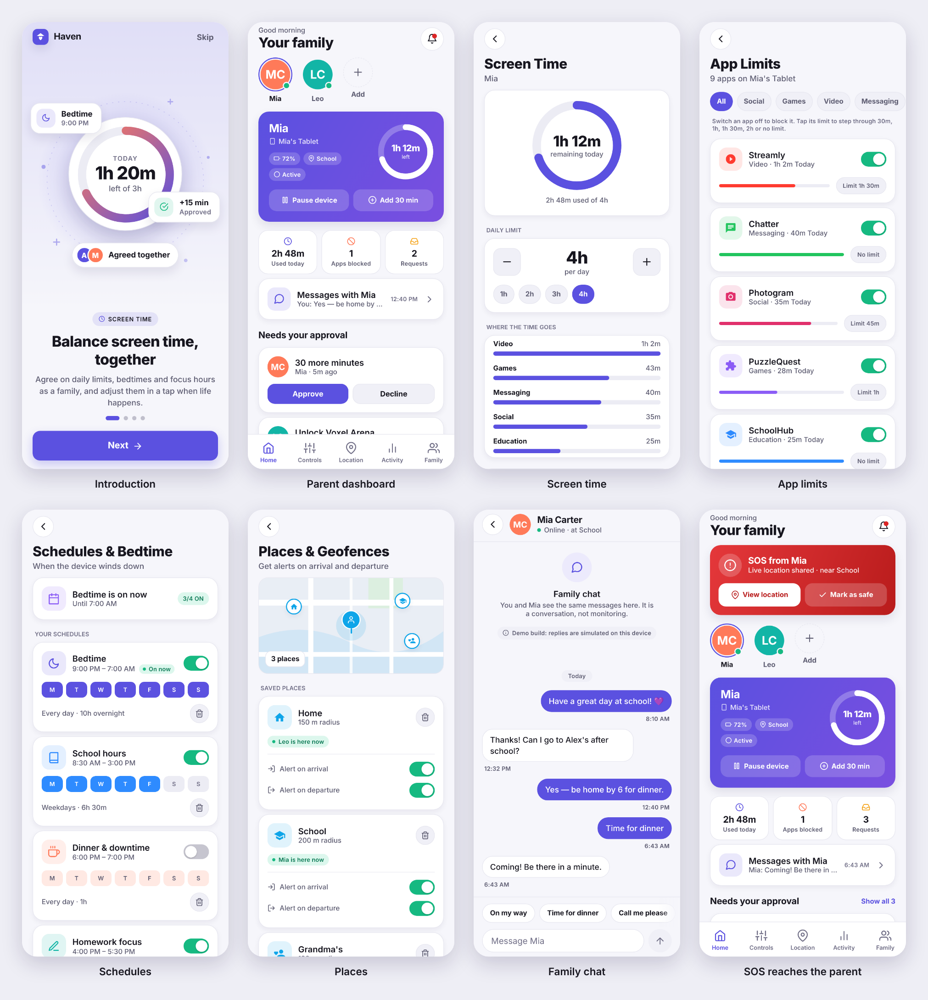
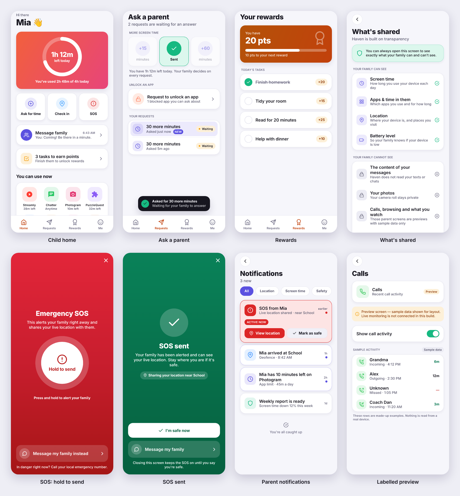

# Haven

A family-safety app for a parent and a child, built with React Native and Expo (SDK 58, Expo Router, TypeScript). **One app, one codebase, two platforms (Android and iOS), two roles.** The repository is named `Vivo-v40e`; the app is called Haven.

Haven is transparent by design: the child can always open a screen that lists exactly what is shared with the family and what is not, and nothing in the app runs in secret.

<p>
  
  
</p>

## How it works

- The same app is installed on every phone. On first start you choose **"I'm a parent"** or **"This is my child's device"**.
- A **parent** signs in with an email address and a password, confirms the address, and creates the family. Signing in on another phone, Android or iPhone, brings the family with it.
- A **child's phone** needs no account. It enters a one-time code from the parent's phone, both phones show the same four characters, and the parent approves it.
- From then on the role is fixed **by the server**. A child's phone cannot open the parent side, and whatever a modified app sends, the server refuses what a child may not do (`firestore.rules`).
- Until a phone is in a family it shows sample data, so the app can be looked at without an account.

| Document | What it covers |
|---|---|
| [docs/SECURITY.md](docs/SECURITY.md) | What the security rules guarantee, how to publish them, their limits |
| [docs/RELEASE.md](docs/RELEASE.md) | Building for Android and iPhone with EAS, installing, over-the-air updates |
| [docs/BACKEND.md](docs/BACKEND.md) | The Firebase project, the data layout, how syncing works |
| [docs/DEMO.md](docs/DEMO.md) | A walkthrough with the sample data |

## What works between two linked phones

Rules and limits set by the parent, requests for more time or to unlock an app and their answers, check-ins, a chat, tasks and rewards, SOS, removing a phone. Changes made without a connection are kept and sent when it is back; a restart keeps everything.

## What this version does not do

Said plainly, because it matters for a safety app:

- It does **not read a phone's location**, **measure screen time or app use**, or **lock the phone or block apps**. Limits and blocked apps are agreements that both phones show. Usage numbers, maps and battery levels on the parent's screens are examples and are marked as such in a linked family.
- It does **not send notifications to a closed app**. An SOS, a request or a message appears on the other phone when Haven is open there.
- **Haven is not an emergency service.** Its SOS reaches a parent only while Haven is open on the parent's phone and both phones have a connection. In danger, call the emergency number.
- Calls, messages in other apps, social apps, browsing and video history, and keyword alerts are labelled preview screens with made-up rows. Nothing reads them from a device, on purpose.

Each of the first two needs native modules and system permissions that differ between Android and iOS; `src/platform/capabilities.ts` is where that difference is described, and "What this version does" in the app shows it to both parent and child.

## Run it

```bash
npm install
npx expo start
```

Press `w` for the browser, or open it in a development build. `firebase.config.json` holds the Firebase project's public client settings; with it the app talks to that project. Without the file the app runs with sample data only.

## Build

EAS builds for both platforms and over-the-air updates: see [docs/RELEASE.md](docs/RELEASE.md).

A local Android APK:

```bash
npm run apk     # expo prebuild, then gradle assembleRelease
```

It compiles against and targets **Android 17 (API 37)**; the minimum is Android 7.0 (API 24). You need the Android SDK (platform 37, build tools 37, NDK 27.1), `ANDROID_HOME`, and JDK 17. The APK is in `android/app/build/outputs/apk/release/`, signed with the debug key: sign it with your own key before handing it on, and keep that key, because Android only installs a later version over an earlier one when both have the same signature.

## Tests

```bash
npx tsc --noEmit      # types
npm run test:sync     # the sync logic: unit cases and 5,000 random histories
npm run test:rules    # the security rules, request by request (Firestore emulator)
npm run test:live     # two phones' real code against the Firestore and Auth emulators
node tests/ui/two-browsers.e2e.js <web export>   # the screens, in two browsers
```

None of them contact the real Firebase project. How to start the emulators is in each folder's README.

## Structure

- `src/app/` — screens (every file is a route). `(parent)/` and `(child)/` are the two tab sides; `_layout.tsx` closes each side to the other role; `account.tsx`, `pairing.tsx` and `link-device.tsx` are setup and linking.
- `src/sync/` — the link between phones: `auth.ts` (accounts), `remote.ts` (Cloud Firestore), `controller.ts` (who is signed in, pairing, status), `engine.ts`, `reconcile.ts` and `schema.ts` (what is sent and how conflicts are settled).
- `src/state/` — the app's data and every action the screens call, saved on the device.
- `src/platform/capabilities.ts` — what each operating system allows and what this build does.
- `src/components/`, `src/theme/` — the UI kit, colours for light and dark.
- `firestore.rules` — the security rules. `tests/` — the suites above.
- `app.json`, `app.config.js`, `eas.json` — app, build and update configuration.
